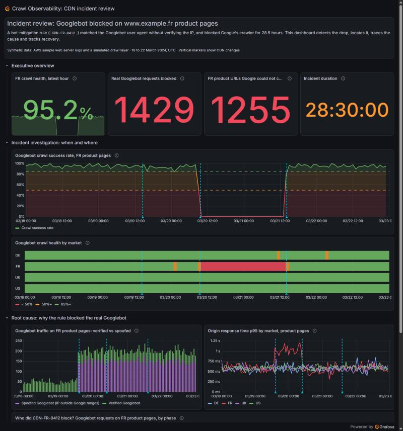
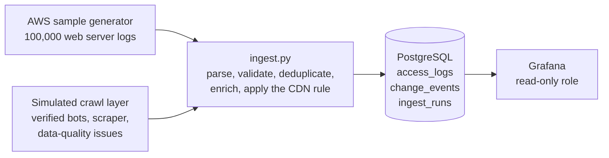

# Crawl Observability: when a CDN rule blocked Googlebot

https://github.com/user-attachments/assets/815fb4a6-e698-40d3-9c00-b8ac8adaf0d0

An investigation into a CDN bot-mitigation rule that accidentally blocked Googlebot from an e-commerce site's French product pages for 28.5 hours. The project uses synthetic web server logs, Python, PostgreSQL and Grafana to trace the incident and assess its SEO impact.

**[Explore the live dashboard](https://joyfulcustard3262.grafana.net/public-dashboards/223fe6ecf3304d8d96b25b87d72ef401)** (read-only; no account required)



## The incident

A scraper impersonates Googlebot while crawling the French product catalogue. As the extra traffic increases server response times, a CDN rule is introduced to block it. The problem: the rule checks for `Googlebot` in the user agent but does not verify the request's IP address. It blocks legitimate Googlebot traffic too.

| Time (UTC) | Event |
|---|---|
| 19 March, 14:00 | A scraper impersonating Googlebot begins crawling `www.example.fr/product/*` |
| 19 March, 14:35 | A latency alert is triggered on the French catalogue |
| 20 March, 09:40 | Rule `CDN-FR-0412` v1 is deployed, blocking any user agent containing `Googlebot` |
| 21 March, 14:10 | Rule v2 is deployed, exempting requests from verified Google IP addresses |

## Dashboard

The dashboard follows the incident from its initial symptoms to the rule change and recovery.

| Section | Question | Panels |
|---|---|---|
| Executive overview | What was the impact? | Crawl health over the latest hour, legitimate Googlebot requests blocked, affected product URLs, incident duration |
| Incident investigation | When did it happen, and which markets were affected? | Hourly Googlebot crawl success rate for French product pages, crawl health by market |
| Root cause | Why was Googlebot blocked? | Legitimate vs spoofed Googlebot traffic, origin p95 response time by market, requests blocked during each rule phase |
| Data quality | How reliable is the dataset? | Rows loaded, duplicate and malformed records removed, unidentified user agents |

Annotations indicate the latency alert, initial rule deployment and fix across the time-series panels.

## Key findings

| | Before the rule | Rule v1 (user agent only) | Rule v2 (verified-bot exception) |
|---|---:|---:|---:|
| Legitimate Googlebot requests served | 2,756 | 0 | 1,612 |
| Legitimate Googlebot requests blocked | 0 | 1,429 | 0 |
| Spoofed Googlebot requests served | 2,971 | 0 | 0 |
| Spoofed Googlebot requests blocked | 0 | 4,315 | 5,016 |
| Googlebot crawl success rate | 94.8% | 0% | 95.3% |

*French product pages only.*

- **Root cause:** Rule v1 relied on the user agent alone. It blocked both the scraper and legitimate Googlebot requests. Rule v2 added an IP-based exception for verified Googlebot traffic.
- **Impact:** 1,255 product URLs received at least one blocked request from legitimate Googlebot, representing around 35% of the 3,598 French product URLs it visited during the period.
- **Initial trigger:** Origin p95 response time on French product pages rose from approximately 600 ms to 1 second after the scraper started. It returned to its previous level once the rule blocked the scraper.
- **Scope:** The issue was limited to France. No sustained decline appears in the German, UK or US sites.

## SEO impact

During the 28.5-hour incident, legitimate Googlebot requests to 1,255 French product URLs were blocked with a `403 Forbidden` response. This prevented Google from retrieving updated content for those requests and created a risk to indexing if the errors persisted.

### Why the HTTP status matters

| Response to Googlebot | How Google handles it |
|---|---|
| `200 OK` | Google can process the content for indexing, although indexing is not guaranteed. |
| **`403 Forbidden` (this incident)** | Google cannot access the page content. URLs that continue returning 403 may eventually be removed from the index. A 403 does not signal Google to reduce its crawl rate. |
| `503 Service Unavailable` or `429 Too Many Requests` | Google treats these as signs of server overload and temporarily reduces crawling. Previously indexed URLs are generally retained initially, but prolonged errors can still lead to removal. |

### Potential consequences

- **Stale product information:** Google could not retrieve price or stock updates from affected pages while requests were blocked. Whether outdated information actually appeared in search results would need to be checked separately.
- **Indexing risk:** Persistent 403 responses can cause affected URLs to be removed from Google's index, with possible consequences for organic visibility and sales.
- **Unsuccessful crawl requests:** Googlebot made 1,429 requests to French product pages during the block. All were refused.

### How to verify recovery

Restoring access resolves the technical error, but does not by itself confirm that indexing has recovered. I would check three sources:

- **Google Search Console, Crawl stats:** trends in 403 responses before and after the fix.
- **Google Search Console, Page indexing:** URLs reported as blocked by a 403 response.
- **Server logs:** the first successful Googlebot request to each affected URL after the fix.

### What I would change

- Verify bots claiming to be Googlebot using reverse DNS with forward confirmation, or Google's published IP ranges, before applying a bot-blocking rule.
- When the goal is to signal temporary server overload to crawlers, use an appropriate `503` or `429` response rather than `403`. This is distinct from blocking an unwanted scraper, where bot verification should determine which requests are allowed.

Reference: [Google's documentation on HTTP status codes and crawling](https://developers.google.com/search/docs/crawling-indexing/http-network-errors).

## How it works



The pipeline in `ingest/ingest.py` has four steps:

1. **Generate base logs:** use the [AWS sample generator](https://github.com/aws-samples/sample-webserver-logs-dataset), with the record count increased from 10,000 to 100,000.
2. **Add the crawl scenario:** simulate legitimate Googlebot and Bingbot traffic across four country sites, a spoofing scraper, other automated traffic, and a small number of duplicate or malformed records.
3. **Validate the data:** parse the AWS logs (in OpenSearch bulk format) and the simulated crawl data, record why malformed lines were rejected, and remove duplicates.
4. **Load the enriched logs:** add fields including market, host, application pool, page type, bot family, IP verification and response time. Apply the simulated CDN rule and load the results into PostgreSQL.

A fixed random seed makes the generated dataset reproducible.

## Data sources and simulation

**The entire dataset is synthetic.** It contains no real user or company data. The AWS generator provides the base log fields; the ingestion script builds the crawl incident and its operational context.

| From the AWS generator | Added by the ingestion script |
|---|---|
| IP, timestamp, HTTP method, path, status, bytes sent, user agent, referrer | Market and host (`www.example.fr`, `.de`, `.co.uk`, `.com`) |
| | Application pool and page type |
| | Legitimate Googlebot and Bingbot traffic, plus the scraper |
| | Simulated bot IP verification |
| | CDN rule behaviour and incident timeline |
| | Response times |
| | Duplicate and malformed records for data-quality checks |

## Metric definitions

- **Crawl success rate:** requests returning an HTTP status below 400, divided by all requests in the same hour.
- **Verified bot:** a request with a Googlebot or Bingbot user agent and an IP address within that search engine's configured ranges. A **spoofed bot** uses the same user agent but an IP outside those ranges.
- **p95 response time:** the response time at or below which 95% of requests fall. Requests blocked by the CDN are excluded because they do not reach the origin server.
- **Incident phases:** calculated from the `change_events` table, rather than hard-coded dates.

## Limitations

- **Simplified bot verification:** IP addresses are checked against a fixed list of ranges. In production, these checks should use verified reverse and forward DNS records or maintained IP ranges published by the search engines.
- **Unverified SEO crawlers:** AhrefsBot and SemrushBot are identified by user agent only.
- **Small hourly samples:** each market has around 30–50 legitimate Googlebot requests per hour. A few failures can noticeably change the hourly rate. Isolated degraded cells in the market overview should not be interpreted as separate incidents without further investigation.
- **Designed scenario:** the incident timeline, traffic patterns and request volumes are defined in the ingestion script. They are not observations from a production system.

## Run it locally

### Option A: Docker

Requires [Docker Desktop](https://www.docker.com/products/docker-desktop/). Download or clone the repository, open a terminal in the project folder, and run:

```bash
cp .env.example .env      # set the three passwords in .env
docker compose up -d
```

Open http://localhost:3000. Grafana opens the dashboard as its home page in read-only mode. On first launch, data generation and loading take approximately one minute.

- `postgres` stores the logs. Its port is not exposed to the host.
- `ingest` generates and loads the dataset, then exits.
- `grafana` accesses PostgreSQL through a read-only role. Its data source and dashboard are configured from `grafana/`.

Grafana listens on `127.0.0.1` only. To publish it on a server, put a reverse proxy such as Caddy or Nginx in front of it, and set `GRAFANA_PORT` in `.env` if port 3000 is already taken.

To clear the database and start again, run `docker compose down -v`.

### Option B: Hosted PostgreSQL and Grafana Cloud

This is the setup used for the live dashboard.

1. Create a PostgreSQL database. The live version uses the free plan from [Neon](https://neon.com).
2. Add its connection string to `.env` as `DATABASE_URL`, then run `pip install -r requirements.txt` followed by `python ingest/ingest.py`.
3. Add the database as a PostgreSQL data source in Grafana, then import `grafana/crawl-observability-dashboard.json` under **Dashboards > New > Import**.

Grafana's public shared dashboards only display annotations saved in Grafana itself. For the live dashboard, I recreated the three incident markers as Grafana annotations. The SQL annotations included in the JSON work in a regular Grafana instance.

## Repository structure

```
ingest/
  ingest.py                  generation, parsing, enrichment, loading
  schema.sql                 tables: access_logs, change_events, ingest_runs, ingest_rejects
vendor/aws_sample_webserver_logs/
                             AWS generator, unchanged (MIT-0 licence)
grafana/
  build_dashboard.py         builds the dashboard JSON from code
  crawl-observability-dashboard.json   version to import manually
  dashboards/                version provisioned by Docker
  provisioning/              data source and dashboard provider
docker/postgres-init/        creates the read-only role for Grafana
docker-compose.yml
.env.example                 configuration template (no secrets)
```

## Credits

Web server logs generated using [aws-samples/sample-webserver-logs-dataset](https://github.com/aws-samples/sample-webserver-logs-dataset) (MIT-0). Built with Python, PostgreSQL, Grafana and Docker.

**Lucie Vaterlaus**
